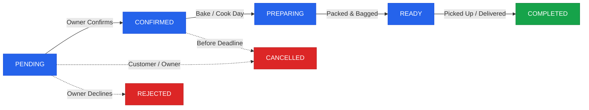

# 🥐 BatchBite – Full-Stack MERN Food Business Management Platform

BatchBite is a professional, production-grade business management and pre-order marketplace tailored specifically for **home-based food businesses, cottage bakers, and artisan chefs**.

Unlike traditional restaurants that cook on guesswork and suffer heavy food waste, BatchBite empowers home food creators to schedule **limited food batches**, cap quantities to their actual kitchen capacity, set pre-order deadlines, accept customer reservations, and cook only what has already been pre-sold.

---

## 🌟 Key Highlights & Engineering Features

- **Atomic Inventory Safety & Race Condition Prevention**: Uses MongoDB atomic conditional updates (`findOneAndUpdate({ _id, availableQuantity: { $gte: requestedQty } })`) so simultaneous orders can never overbook a batch beyond kitchen capacity.
- **Strict Order Deadline Enforcement**: Automatically prevents customer ordering once the batch order deadline has passed, giving chefs the exact ingredient totals needed for prep day.
- **Full Order Lifecycle Management**:
  `PENDING → CONFIRMED → PREPARING → READY → COMPLETED` (with `CANCELLED` and `REJECTED` handling).
- **Snapshot Pricing & Product Data**: Orders record immutable snapshots of product names and batch prices at purchase time, safeguarding historical financial accuracy.
- **Automated Inventory Restorations**: If an order in `PENDING` or `CONFIRMED` status is cancelled or declined prior to the deadline, reserved quantities are released back to available batch inventory.
- **Business Dashboard & Revenue Analytics**: Real-time sales statistics, active batch capacity utilization bars, order status breakdowns, and printable sales reports.
- **Localized Currency Support (INR - ₹)**: Built-in Indian Rupee formatting (`₹`) with localized currency formatting and `en-IN` number presentation across customer menus, cart, checkout, order tracking, business dashboard, and sales reports.
- **Zero-Setup Standalone Database Fallback**: Built-in `MongoMemoryServer` fallback ensures the entire backend and seeding script run out of the box even if local MongoDB service is not running.

---

## 🛠️ Technology Stack

### Frontend
- **React.js** (Create React App – standard CRA setup)
- **React Hooks** (`useState`, `useEffect`, `useContext`, `useCallback`)
- **React Router DOM v6** (Nested routes, Protected routes, Role-based route guards)
- **Axios** (Centralized instance with JWT authorization interceptors)
- **Bootstrap 5** & **Bootstrap Icons** (Clean, mobile-first responsive design)
- **React Toastify** (Real-time feedback and notifications)

### Backend
- **Node.js** & **Express.js** (MVC architecture)
- **JWT (JSON Web Tokens)** for stateless authentication
- **bcryptjs** for secure password hashing (minimum 10 salt rounds)
- **CORS** & Express JSON body parsing

### Database
- **MongoDB** & **Mongoose** (Relational-style document modeling with ObjectIds)
- 6 Collections: `User`, `Business`, `Product`, `Batch`, `BatchItem`, `Order`

---

## 👥 User Roles & Capabilities

### A. Business Owner
1. **Authentication & Profile**: Register and sign in with email/password; customize kitchen name, cuisine type, porch pickup directions, and open/closed availability.
2. **Product Catalog**: Add, edit, activate/deactivate dishes with high-res photos, portion sizes, base prices, and dietary flags (Vegetarian, Vegan, Gluten-Free, Halal, Nut-Free).
3. **Batch Management**:
   - Create limited batches with preparation dates and strict order deadlines.
   - Allocate multiple catalog dishes into a batch, setting batch-specific prices and maximum portion capacity.
   - Configure pickup time windows and optional local doorstep delivery with delivery fees.
   - Open, close, advance to prep, mark ready, or complete batches.
4. **Order Management**: Review incoming pre-orders, advance through the 5-stage lifecycle, view customer notes, and decline/cancel with automated inventory releases.
5. **Dashboard & Sales Analytics**: Live metrics for total orders, pending orders, confirmed sales revenue, capacity utilization bars, and detailed dish/batch sales breakdowns.

### B. Customer
1. **Browse Batches**: Discover open food batches announced by neighborhood home chefs with preparation schedules and remaining countdowns.
2. **Detailed Batch Menus**: View dish ingredients, dietary tags, and remaining portion counts.
3. **Cart & Atomic Pre-Ordering**: Add portions within allowed limits, choose between porch pickup or local delivery, and submit pre-orders.
4. **Live Order Tracking**: Visual 5-step lifecycle tracker (`PENDING` through `COMPLETED`) with timestamped status history and kitchen notes.
5. **Pre-Order Cancellation**: Cancel active pre-orders prior to the order deadline; reserved quantities are safely restored to the batch.
6. **Account Settings**: Manage contact details, phone, and default delivery addresses.

---

## 🚀 Quick Start Guide

### 1. Prerequisites
- **Node.js**: v18.0.0 or higher
- **npm**: v8.0.0 or higher

### 2. Backend Setup
```bash
# Navigate to backend directory
cd backend

# Install dependencies
npm install

# (Optional) Verify backend/.env configuration
# PORT=5000
# MONGO_URI=mongodb://127.0.0.1:27017/batchbite
# JWT_SECRET=batchbite_super_secret_jwt_key_2026_secure

# Start the server (auto-seeds demo data on first start)
npm start
```
The backend API server will run at `http://localhost:5000`.

### 3. Frontend Setup
```bash
# Open a new terminal and navigate to frontend directory
cd frontend

# Install dependencies
npm install

# Start the Create React App development server
npm start
```
The React frontend application will open at `http://localhost:3000`.

---

## 🔑 Demo Accounts (Pre-Seeded)

The application includes sample artisanal kitchens and customers pre-seeded into the database:

| Role | Name | Email | Password | Kitchen / Role Description |
| :--- | :--- | :--- | :--- | :--- |
| **Owner** | Elena Rostova | `owner@batchbite.com` | `password123` | *Elena's Artisan Sourdough & Patisserie* |
| **Owner** | Chef Rajan Patel | `raj@batchbite.com` | `password123` | *Dawat Heritage Home Feasts* |
| **Customer** | Sarah Jenkins | `customer@batchbite.com` | `password123` | Customer with confirmed sourdough orders |
| **Customer** | Marcus Vance | `marcus@example.com` | `password123` | Customer with pending delivery orders |

> **Tip**: On the **Login** page, quick-fill buttons allow 1-click credential population for rapid evaluation.

---

## 📁 Project Structure

```
BatchBite/
├── backend/
│   ├── config/
│   │   └── db.js                  # MongoDB connection with MongoMemoryServer fallback
│   ├── controllers/
│   │   ├── authController.js      # Register, login, profile updates
│   │   ├── businessController.js  # Profile, dashboard stats, orders, sales report
│   │   ├── productController.js   # Product catalog CRUD with batch safety
│   │   ├── batchController.js     # Batch scheduling and product item allocations
│   │   └── orderController.js     # Atomic reservation, tracking, cancellation
│   ├── middleware/
│   │   ├── authMiddleware.js      # JWT verification & role authorization
│   │   └── errorMiddleware.js     # Global 404 and structured error handler
│   ├── models/
│   │   ├── User.js                # Customer & Owner accounts with bcrypt
│   │   ├── Business.js            # Kitchen profiles and pickup instructions
│   │   ├── Product.js             # Food dishes, base prices, dietary tags
│   │   ├── Batch.js               # Scheduled batch runs with deadlines
│   │   ├── BatchItem.js           # Product capacity and booking counts
│   │   └── Order.js               # Orders, price snapshots, lifecycle history
│   ├── routes/
│   │   ├── authRoutes.js
│   │   ├── businessRoutes.js
│   │   ├── productRoutes.js
│   │   ├── batchRoutes.js
│   │   └── orderRoutes.js
│   ├── utils/
│   │   ├── generateToken.js       # JWT token generator
│   │   └── seedData.js            # Comprehensive demo data seeder
│   ├── .env                       # Environment variables
│   ├── package.json
│   └── server.js                  # Main server entry point
│
├── frontend/
│   ├── public/
│   │   ├── index.html
│   │   └── manifest.json
│   ├── src/
│   │   ├── components/
│   │   │   ├── common/
│   │   │   │   ├── Navbar.js      # Role-aware navigation & cart badge
│   │   │   │   ├── Footer.js
│   │   │   │   ├── ProtectedRoute.js
│   │   │   │   ├── Loader.js
│   │   │   │   └── Badge.js       # Status and dietary indicators
│   │   │   ├── owner/
│   │   │   │   ├── OwnerSidebar.js
│   │   │   │   └── OwnerHeader.js
│   │   │   └── customer/
│   │   │       ├── BatchCard.js
│   │   │       ├── ProductCard.js
│   │   │       └── OrderStatusTracker.js
│   │   ├── context/
│   │   │   ├── AuthContext.js     # Auth state, login, register, profile
│   │   │   └── CartContext.js     # Cart state with batch isolation
│   │   ├── pages/
│   │   │   ├── common/
│   │   │   │   ├── Home.js
│   │   │   │   ├── About.js
│   │   │   │   ├── Contact.js
│   │   │   │   ├── Login.js
│   │   │   │   ├── Register.js
│   │   │   │   └── NotFound.js
│   │   │   ├── customer/
│   │   │   │   ├── AvailableBatches.js
│   │   │   │   ├── BatchDetails.js
│   │   │   │   ├── ProductDetails.js
│   │   │   │   ├── Cart.js
│   │   │   │   ├── Checkout.js
│   │   │   │   ├── CustomerDashboard.js
│   │   │   │   ├── MyOrders.js
│   │   │   │   ├── OrderDetails.js
│   │   │   │   └── CustomerProfile.js
│   │   │   └── owner/
│   │   │       ├── OwnerDashboard.js
│   │   │       ├── BusinessProfile.js
│   │   │       ├── ManageProducts.js
│   │   │       ├── AddProduct.js
│   │   │       ├── EditProduct.js
│   │   │       ├── ManageBatches.js
│   │   │       ├── CreateBatch.js
│   │   │       ├── OwnerBatchDetails.js
│   │   │       ├── ManageOrders.js
│   │   │       ├── OwnerOrderDetails.js
│   │   │       └── SalesReport.js
│   │   ├── services/
│   │   │   └── api.js             # Axios instance with interceptors
│   │   ├── utils/
│   │   │   └── formatCurrency.js  # Indian Rupee (₹) formatter
│   │   ├── App.css                # Custom theme & dashboard styling
│   │   ├── App.js                 # Complete application routing table
│   │   └── index.js               # Application bootstrap
│   └── package.json
│
├── package.json                   # Root package with concurrently scripts
└── README.md
```

---

## 📡 REST API Reference

### Authentication
- `POST /api/auth/register` – Register customer or business owner
- `POST /api/auth/login` – Login and retrieve JWT token
- `GET /api/auth/me` – Fetch currently authenticated user (Private)
- `PUT /api/auth/profile` – Update user contact and password (Private)

### Products
- `GET /api/products` – List food products (query: `businessId`, `category`, `search`)
- `GET /api/products/:id` – Retrieve product details
- `POST /api/products` – Create dish in owner's catalog (Owner only)
- `PUT /api/products/:id` – Update product specifications (Owner only)
- `DELETE /api/products/:id` – Delete or safely deactivate product (Owner only)

### Batches
- `GET /api/batches` – List batches (Open & active by default; query: `all=true`)
- `GET /api/batches/:id` – Retrieve batch details and item capacities
- `POST /api/batches` – Schedule a new batch with product allocations (Owner only)
- `PUT /api/batches/:id` – Update batch schedule or items (Owner only)
- `PATCH /api/batches/:id/status` – Quick update batch status (Owner only)

### Orders
- `POST /api/batches/:id/orders` – Place customer pre-order with atomic inventory reservation
- `GET /api/orders/my` – Retrieve logged-in customer's order history (Customer only)
- `GET /api/orders/:id` – Order tracking details (Customer or Owner of the business)
- `PATCH /api/orders/:id/cancel` – Cancel order and release reserved portions (Customer only)

### Business & Dashboard
- `GET /api/business/profile` – Retrieve owner's kitchen profile (Owner only)
- `PUT /api/business/profile` – Update kitchen branding and pickup instructions (Owner only)
- `GET /api/business/orders` – List all orders received by this kitchen (Owner only)
- `PATCH /api/business/orders/:id/status` – Update order lifecycle stage (Owner only)
- `GET /api/business/dashboard` – Real-time counts, capacity monitors, and recent orders (Owner only)
- `GET /api/business/reports/sales` – Detailed sales and revenue report (Owner only)

---

## 🔄 Order Lifecycle & Inventory Rules



1. **Ordering Window**: Orders are accepted only while `batch.status === 'OPEN'` AND `new Date() <= orderDeadline`.
2. **Atomic Quantity Decrement**: Each order item conditionally decrements `availableQuantity` and increments `orderedQuantity` atomically in MongoDB.
3. **Cancellation Window**: Customers can cancel an order if its status is `PENDING` or `CONFIRMED` AND current time is before the batch order deadline.
4. **Inventory Restoration**: Upon cancellation or rejection, the exact ordered quantities are atomically added back to `availableQuantity`.

---

## 💻 Full-Stack Development Phases Completed

- [x] **Phase 1**: Project setup and folder structure
- [x] **Phase 2**: Express server setup and MongoDB connection with smart in-memory fallback
- [x] **Phase 3**: Mongoose models (`User`, `Business`, `Product`, `Batch`, `BatchItem`, `Order`)
- [x] **Phase 4**: User registration and login with bcryptjs password hashing
- [x] **Phase 5**: JWT authentication and role-based authorization middleware
- [x] **Phase 6**: Business profile management and public kitchen storefront
- [x] **Phase 7**: Product catalog CRUD operations with active status control
- [x] **Phase 8**: Batch scheduling with product allocations, deadlines, and capacity limits
- [x] **Phase 9**: Customer storefront, batch discovery, and search/filtering
- [x] **Phase 10**: Shopping cart with batch isolation and quantity validation
- [x] **Phase 11**: Pre-order placement with atomic inventory reservations
- [x] **Phase 12**: Order status progression (`PENDING` → `CONFIRMED` → `PREPARING` → `READY` → `COMPLETED`)
- [x] **Phase 13**: Business dashboard with sales metrics and capacity monitors
- [x] **Phase 14**: Connected React frontend with Axios interceptors and Bootstrap 5 styling
